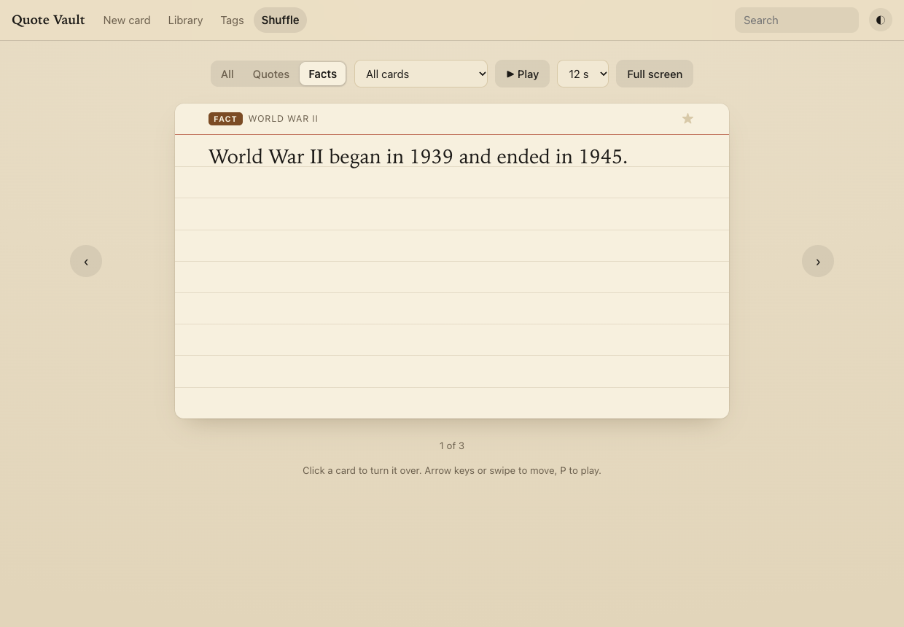

# Quote Vault

A personal app for the sentences you highlight while reading. Each one becomes an index card: the quote on the front; your keyword, tags and note on the back. Cards are stored as plain Markdown, one file per book, person or topic.

It runs on your own Mac, uses local AI only, and is reachable from a phone on the same Wi-Fi.



## What it does

- **Type or dictate** a card, in Turkish or English. Dictation uses Whisper running on the Mac.
- **Turkish typed on an English keyboard is repaired**: `dunyanin en guzel seyi` becomes `dünyanın en güzel şeyi`. A safety check accepts only letter-level changes, so the model cannot rewrite your quote.
- **Quotes are checked online** against Wikiquote, Wikisource, Google Books and Open Library. You get "verified", a "did you mean…?" with the source's wording, or "not found". Nothing is changed without your say-so.
- **Turkish quotes get a second check**: the quote is translated, searched for in English sources and compared by meaning, to find the original passage.
- **Tags are suggested automatically**, always in English, reusing the tags you already have.
- **Quotes and facts**: a card is either someone's words or a piece of information to remember.
- **Shuffle mode** shows cards one at a time, from one book, person, topic or tag, or facts only, with an optional slideshow.
- **Book and person details** (year, publisher, cover, life dates) are looked up for you.

## Requirements

- A Mac with Apple Silicon (voice input uses MLX)
- Python 3.13
- [Homebrew](https://brew.sh), for `ffmpeg` and `ollama`
- About 12 GB of disk space for the models, and 16 GB of memory

## Setup

```sh
python3 -m venv .venv
.venv/bin/pip install -r requirements.txt

brew install ffmpeg ollama
ollama serve &                 # only needed while downloading the models
ollama pull gemma4:e4b         # tidy-up, tags, translation (about 9.5 GB)
ollama pull bge-m3             # compares sentences by meaning (about 1.2 GB)

./run.sh                       # then open http://127.0.0.1:8765
```

The Whisper model (about 1.5 GB) downloads the first time you dictate.

### As a Mac app

```sh
launcher/build.sh              # builds "Quote Vault.app" into /Applications
```

Opening the app starts the server and the local model; closing its window stops both. Nothing runs at login. Building it needs the Xcode command line tools (`xcode-select --install`).

### On a phone

While the app is open on the Mac, open `http://<your-mac-name>.local:8765` on a phone on the same Wi-Fi (the Library page shows the exact address). Typing works straight away. The phone's microphone needs a one-time setup, because phone browsers only allow it over https: run `scripts/setup-phone-https.sh` and follow what it prints.

## Settings

Optional. Create `settings.json` in the project folder:

```json
{
  "contact": "you@example.com",
  "google_books_key": "your-key"
}
```

| Setting | What it is for |
|---|---|
| `contact` | An email or web address sent with lookups to Wikimedia and Open Library, which ask automated programs to identify themselves. Without it, Wikiquote, Wikisource and Wikipedia refuse the lookups. |
| `google_books_key` | A free Google API key for the Books API. Without it, Google Books is usually over its shared quota. |
| `library` | Where the cards are kept. Default: `library/` in the project folder. |
| `llm_model`, `embed_model`, `whisper_model` | Which local models to use. See `app/config.py` for all settings and defaults. |

`settings.json` and `library/` are not part of this repository.

## What leaves your Mac

- The quote text, and the book title or person name you type, are sent as searches to the sources listed above and to DuckDuckGo.
- Voice recordings, notes, keywords, tags and files never leave the Mac. The language model and Whisper run locally.
- The server listens on your local network so that your phone can reach it. It has no login, so use it on a network you trust.

## Where your cards live

```
library/
  books/    one file per book
  people/   one file per person, for quotes that are not from a book
  topics/   one file per topic, for facts with no single book or person
```

A file looks like this, and can be edited by hand or opened in any Markdown editor:

```markdown
---
title: Tutunamayanlar
author: Oğuz Atay
year: 1972
---

> The quote goes here.

- id: q7f3a1c
- page: 142
- keyword: yalnızlık
- tags: solitude, identity
- added: 2026-11-17
- verified: yes

---
```

## Development

```sh
.venv/bin/python -m pytest tests                               # unit tests
.venv/bin/python scripts/eval_models.py --no-think gemma4:e4b  # score a local model
```

| Path | What is in it |
|---|---|
| `app/storage.py` | Reads and writes the Markdown files |
| `app/textfix.py` | Language detection, Turkish letter repair, the safety check |
| `app/verify.py` | The online quote check |
| `app/crosscheck.py` | The cross-language check for Turkish quotes |
| `app/llm.py` | The only module that talks to the language model |
| `app/main.py`, `app/serve.py` | The web server and how it starts |
| `static/` | The interface: plain HTML, CSS and JavaScript, no build step |
| `launcher/` | Builds the Mac app |

`IDEAS.md` lists known weak spots and what might come next.
